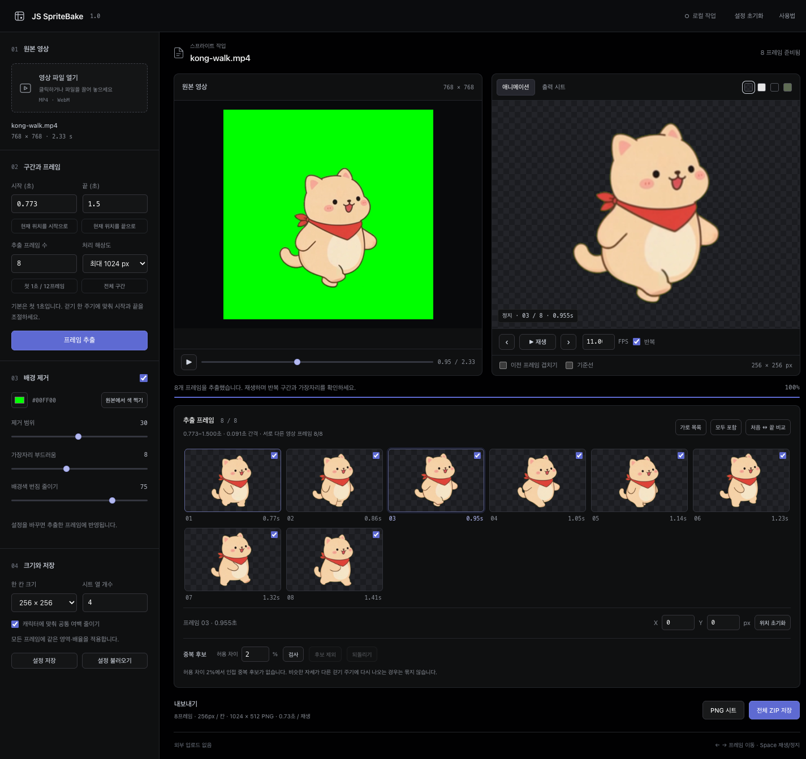

# JS SpriteBake

**手元の動画から、透過スプライトシートを作成。**

[English](README.md) · [한국어](README.ko.md) · 日本語

[v1.0.0をダウンロード](https://github.com/JongSeok-327/js-spritebake/releases/tag/v1.0.0) · MIT · APIキー不要 · 動画はPCの外に出ません



単色背景の前で撮ったキャラクター動画から範囲を選ぶと、等間隔でフレームを取り出して背景を除去します。アニメーション全体に同じ切り抜き範囲と倍率を適用し、透過PNGシートとして保存します。ゲームエンジン向けに、個別フレームとフレームごとの再生時間を含むZIPも保存できます。

使い方は3通りです。

| | 向いている作業 | 必要なもの |
| --- | --- | --- |
| [**編集画面**](#クイックスタート) | 背景色・除外フレーム・位置を見ながら調整 | Python 3.9+ · Chrome または Edge |
| [**コマンドライン**](#コマンドラインcli) | 同じ設定の繰り返し、スクリプト、一括処理 | Node.js 22+ · Chrome または Edge |
| [**Claude Code スキル**](#claude-code-スキル) | 「この動画でスプライトシートを作って」と言葉で依頼 | Claude Code · Node.js 22+ · Chrome または Edge |

編集画面は韓国語です。この説明では各ボタンに日本語の意味を併記しています。

## 作ったきっかけ

キャラクター動画をスプライトにする作業をしていて、こういう小さなツールがあると便利だと思い、作りました。自分で使いながら少しずつ調整してきた作業用ツールですが、同じような作業をする方にも役立てばと思って公開しています。

## クイックスタート

### macOS

1. [リリースのZIP](https://github.com/JongSeok-327/js-spritebake/releases/tag/v1.0.0)をダウンロードして展開します。
2. **ターミナル**を開き、`cd `(後ろに半角スペース)と入力してから、展開したフォルダーをウィンドウにドラッグしてReturnを押します。
3. 実行します。

   ```sh
   ./start.command
   ```

4. ブラウザーで **http://127.0.0.1:8765** が開きます。作業中はターミナルを開いたままにし、終了するには **Control+C** を押します。

macOSには `python3`(3.9)が最初から入っています。ターミナルが **コマンドライン・デベロッパ・ツール** のインストールを求めたら、インストールしてからもう一度実行してください。[python.org](https://www.python.org/downloads/)で新しいバージョンを入れている場合は、自動的にそちらを使います。

Finderで `start.command` をダブルクリックしても起動できます。署名のないスクリプトなので、初回はmacOSにブロックされることがあります。その場合はターミナルから実行するか、**システム設定 → プライバシーとセキュリティ** でそのファイルの **このまま開く** を押してください。セキュリティ機能をオフにする必要はありません。

### Windows

1. [python.org](https://www.python.org/downloads/)からPython 3.9以降をインストールします。インストーラーで **Add python.exe to PATH** にチェックを入れてください。
2. [リリースのZIP](https://github.com/JongSeok-327/js-spritebake/releases/tag/v1.0.0)をダウンロードし、**フォルダー全体を展開**します。ZIPの中から直接は実行できません。
3. **`start.cmd` をダブルクリック**します。`py -3` または `python` を探して起動し、ブラウザーを開きます。
4. 作業中はコマンドウィンドウを開いたままにし、終了するにはそのウィンドウで **Ctrl+C** を押します。

Pythonがすでにある場合は、プロジェクトのフォルダーで `python3 server.py`(macOS)または `py -3 server.py`(Windows)でも起動できます。

## 編集画面の使い方

1. **영상 파일 열기**(動画を開く):動画を選ぶか、ドラッグします。MP4(H.264)とWebMが最も安定しています。
2. **시작 / 끝**(開始 / 終了)と **추출 프레임 수**(フレーム数):最初は先頭1秒・12フレームです。歩行なら1歩の周期全体を選びます。終了時刻は取り出さないため、ループ動画の最初のポーズが二重になりません。
3. **프레임 추출**(フレーム抽出)を押します。
4. **배경 제거**(背景除去):色を指定するか、**원본에서 색 찍기**(元動画から色を取得)で背景をクリックします。縁に緑が残る場合はにじみ抑制か許容範囲を上げ、キャラクターの一部が消える場合は許容範囲を下げます。明るい背景と暗い背景の両方で確認してください。
5. ‹ › ボタン、オニオンスキン、チェックボックスでフレームを確認します。X/Yで選択中のフレームの位置を調整でき、**출력 시트**(出力シート)で保存時の配置を確認できます。
6. **중복 후보**(重複候補)は、ほぼ同じ隣接フレームを示します。候補を押すと2枚を交互に比較し、**후보 제외**(候補を除外)で結合、**되돌리기**(元に戻す)で復元します。結合したフレームの時間は前のフレームに加算されます。
7. **PNG 시트**(PNGシート)または **전체 ZIP 저장**(ZIPで一括保存)で保存します。

作業は自動保存されません。後で続けるには **설정 저장**(設定を保存)を押しておきます。次回、同じ動画を開いて設定を読み込み、再抽出すると復元されます。

**撮影のコツ**:カメラを固定し、武器や小物まで余裕をもって全身を映します。背景はキャラクターに含まれない1色で均一にするのが理想です。移動をゲーム側で処理するなら、その場歩きが最も扱いやすいです。

## 出力ファイル

| ファイル | 内容 |
| --- | --- |
| `*-sheet.png` | 透過スプライトシート(グリッド) |
| `frames/001.png` … | 個別の透過フレーム(ZIPのみ) |
| `*.json` | 各フレームのシート上の位置、元動画の時刻、補正位置、基準点、`durationMs`(ZIPのみ) |
| `*-settings.json` | 作業を復元するための設定とフレーム編集。動画は含みません。 |

**重複候補を結合した場合は、ゲーム内で各フレームを `durationMs` だけ表示してください。** 元の速度が保たれます。PNGだけではフレームごとの時間を保存できません。手動でチェックを外したフレームは、その時間も除かれます。

既定の基準点 `(0.5, 0.9)` はセル内の固定位置で、足の位置を自動検出したものではありません。ガイド、フレーム番号、オニオンスキンはPNGに書き込まれません。

## コマンドライン(CLI)

`cli.mjs` は非表示のChrome/Edgeで編集画面と同じ処理を実行するため、結果も同じです。[Node.js 22+](https://nodejs.org/)とChromeまたはEdgeがあれば動き、Pythonは不要です。

```sh
node cli.mjs walk.mp4                                   # 先頭1秒・12フレーム → walk-sprites.zip
node cli.mjs walk.mp4 --start 0.5 --end 1.5 --frames 16 --dedupe
node cli.mjs walk.mp4 --key-color "#0000ff" --format png --out sprites
node cli.mjs walk.mp4 --preset walk-settings.json       # 編集画面で保存した設定を再利用
```

進行状況はstderrに、保存したファイルのパスはstdoutの最終行に出力されます。すべてのオプションは `node cli.mjs --help` で確認できます。

| オプション | 意味 | 既定値 |
| --- | --- | --- |
| `--start`, `--end` | 範囲(秒)。終了時刻は取り出さない | 0 → 先頭1秒 |
| `--frames` | 取り出すフレーム数、2–64 | 12 |
| `--resolution` | 処理解像度の上限:512, 1024, 2048 | 1024 |
| `--key-color` | 除去する背景色 `#rrggbb` | `#00ff00` |
| `--tolerance`, `--softness`, `--despill` | 1–60, 0–20, 0–100 | 30, 8, 75 |
| `--no-key` | 背景を残す | |
| `--cell`, `--columns` | セルサイズ 128/256/512/1024、列数 1–16 | 256, 4 |
| `--no-crop` | 共通の切り抜きを使わない | |
| `--fps` | JSONに書き込む再生FPS | フレーム数 ÷ 範囲 |
| `--dedupe` | 重複候補を結合(合計時間は維持) | |
| `--preset` | 編集画面で保存した設定JSON(オプションが優先) | |
| `--format` | `zip` または `png` | `zip` |
| `--out` | 保存先フォルダー | 現在のフォルダー |
| `--browser` | 標準の場所にない場合のChrome/Edgeのパス | 自動 |

`npm run bake -- walk.mp4` でも実行でき、`npm link` 後は `spritebake walk.mp4` も使えます。

## Claude Code スキル

このリポジトリは [Claude Code](https://claude.com/claude-code) のプラグインでもあります。コマンドラインを代わりに実行する `spritebake` スキルが入っています。Claude Codeでインストールしてください。

```
/plugin install js-spritebake --marketplace JongSeok-327/js-spritebake
```

古いバージョンのClaude Codeでは、`/plugin marketplace add JongSeok-327/js-spritebake` のあと `/plugin install js-spritebake@js-spritebake` の2段階でインストールします。

インストール後は普段の言葉で依頼できます。例:*「~/Movies/walk.mp4 からスプライトシートを作って。背景は緑、8フレーム、./sprites に保存」*。Claudeがオプションを選んでCLIを実行し、シートを確認してから返答します。このリポジトリ内で作業するときは、インストールせずに `claude --plugin-dir .` でスキルを読み込めます。

## トラブルシューティング

| 症状 | 対処 |
| --- | --- |
| `Python 3.9 or newer is required` | [python.org](https://www.python.org/downloads/)からPythonをインストールし、ターミナルを開き直してください。 |
| macOSで `start.command` が開けない | ターミナルで `./start.command` を実行するか、システム設定 → プライバシーとセキュリティで **このまま開く** を押してください。 |
| `./start.command` で `Permission denied` | `chmod +x start.command` を一度実行してください。 |
| ブラウザーが開かない | ターミナルに表示されたURLをChromeまたはEdgeに貼り付けてください。 |
| `No free local port` | `python3 server.py --port 8900` で起動してください。 |
| 動画が読み込めない | ブラウザーがそのコーデックに対応していません。信頼できるツールでMP4(H.264)かWebMに変換してください。 |
| アニメーションがほとんど動かない | フレーム数に対して範囲が短すぎる(同じフレームの繰り返し)か、長すぎます(ポーズの抜け)。フレーム一覧の上の抽出診断を確認してください。 |
| `Chrome or Edge was not found`(CLI) | どちらかをインストールするか、`--browser <パス>` または `SPRITEBAKE_BROWSER` を指定してください。 |
| `Node.js 22 or newer is required`(CLI) | [nodejs.org](https://nodejs.org/)からLTS版をインストールしてください。 |
| 画面が古いまま | 強制再読み込み:Ctrl+F5(Windows)、Command+Shift+R(macOS) |

検証環境:Windows(Python 3.11、Chrome)、Apple SiliconのmacOS(標準のPython 3.9、Chrome)。Safari、Firefox、スマートフォンは検証していません。

## 制限

- 2–64フレーム、処理解像度は最大2048px(元動画より拡大はしません)。大きな作業は多くのメモリーを使います。重くなったら解像度かフレーム数を下げてください。
- 背景除去は色ベース(クロマキー)で、AIは使いません。背景と同じ色の部分、ブレ、影、細い髪は撮影段階での対策をおすすめします。
- 歩行周期の自動検出、手ぶれ補正、フレーム補間はありません。重複検出はヒューリスティックです。

## プライバシーとセキュリティ

- 動画はブラウザー内で読み込み・処理します。アップロード、アカウント、分析、Cookie、外部への通信はありません。
- ローカルサーバーは `127.0.0.1` でのみ待ち受け、アプリのファイルだけを配信し、他のホスト・オリジンからのリクエストを拒否します。ポート転送やトンネルで外部に公開しないでください。
- 書き出したJSONには元のファイル名が含まれます。共有前に確認してください。

詳細は [SECURITY.md](SECURITY.md) をご覧ください。

## 開発

ビルドや `pip`/`npm install` は不要です。

```sh
npm run check && npm test                                  # 構文 + コアロジック(Node 22+)
python3 -m unittest discover -s tests -p "test_*.py"       # サーバーのセキュリティ境界
node tests/browser-check.mjs http://127.0.0.1:8765         # 編集画面 + CLI の総合チェック(サーバー起動中)
```

ブラウザーチェックはテスト動画を自分で生成し、一時ファイルをgit管理外の `.qa/` に保存します。READMEのスクリーンショットを更新するには `UPDATE_PREVIEWS=1` を、Chromeが標準の場所にない場合は `SPRITE_TEST_BROWSER` を指定してください。[CONTRIBUTING.md](CONTRIBUTING.md) も参照してください。

## ライセンスと参考資料

[MIT](LICENSE)。このプロジェクトのコードとドキュメントに適用され、読み込んだ動画やキャラクターには適用されません。参考資料は [ACKNOWLEDGEMENTS.md](ACKNOWLEDGEMENTS.md)、変更履歴は [CHANGELOG.md](CHANGELOG.md) にあります。
