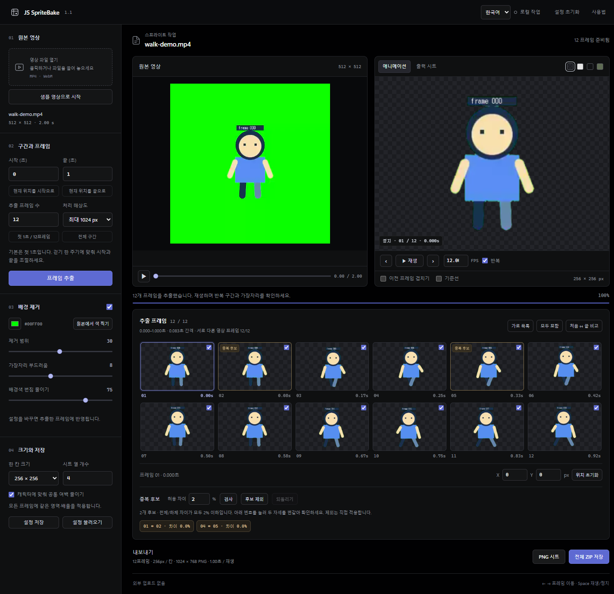
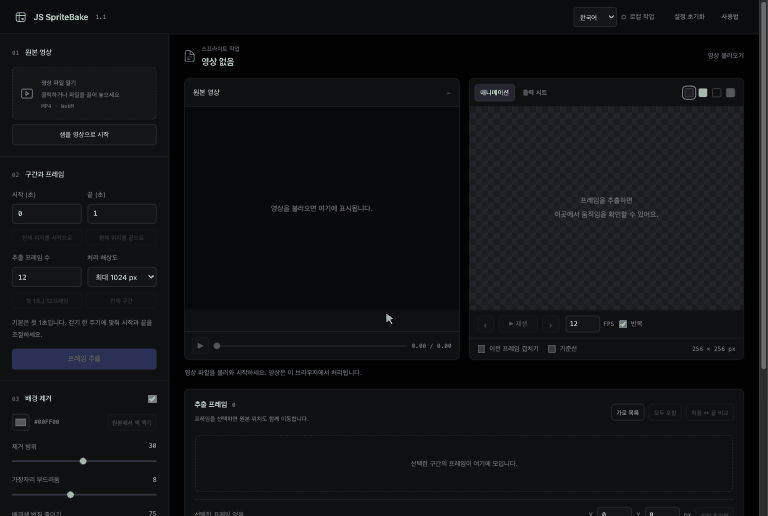

# JS SpriteBake

**내 영상으로 만드는 투명 스프라이트 시트.**

[English](README.md) · 한국어 · [日本語](README.ja.md)

[v1.1.0 다운로드](https://github.com/JongSeok-327/js-spritebake/releases/tag/v1.1.0) · MIT · API 키 불필요 · 영상이 내 컴퓨터 밖으로 나가지 않음


단색 배경 앞에서 찍은 캐릭터 영상에서 구간을 고르면, 일정한 간격으로 프레임을 뽑아 배경을 지웁니다. 애니메이션 전체에 같은 잘라내기 영역과 배율을 적용해 투명 PNG 시트로 저장합니다. 게임 엔진용으로 개별 프레임과 프레임별 재생 시간이 든 ZIP도 저장할 수 있습니다.

[](docs/assets/editor-ko.png)

**영상이 아직 없다면?** 편집 화면에서 **샘플 영상으로 시작**을 누르세요. 제 게임 *kong-survivors*의 주인공 콩이 걷는 2초짜리 영상을 불러와 걷기 한 주기를 뽑고 재생합니다. [샘플 설명](docs/SAMPLES.md)

사용 방법은 세 가지입니다.

| | 이런 때 좋아요 | 필요한 것 |
| --- | --- | --- |
| [**편집 화면**](#빠른-시작) | 배경색, 제외할 프레임, 위치를 눈으로 보며 조절 | Python 3.9+ · Chrome 또는 Edge |
| [**명령줄(CLI)**](#명령줄cli) | 같은 설정 반복, 스크립트, 여러 파일 일괄 처리 | Node.js 22+ · Chrome 또는 Edge |
| [**Claude Code 스킬**](#claude-code-스킬) | "이 영상으로 스프라이트 시트 만들어줘"처럼 말로 요청 | Claude Code · Node.js 22+ · Chrome 또는 Edge |

편집 화면은 **English, 한국어, 日本語**를 지원합니다. 오른쪽 위에서 언어를 바꿔도 영상과 편집 내용은 그대로입니다. 처음에는 브라우저 언어를 따르고, 주소 끝에 `?lang=en`, `?lang=ko`, `?lang=ja`를 붙이면 해당 언어로 열립니다.

## 만든 이유

캐릭터 영상을 스프라이트로 만드는 작업을 하다 보니, 이런 도구가 있으면 편하겠어서 만들었습니다. 직접 쓰면서 조금씩 다듬은 개인 작업 도구인데, 비슷한 작업을 하는 분들에게도 도움이 될까 해서 공유합니다.

## 빠른 시작

### macOS

1. [릴리스 ZIP](https://github.com/JongSeok-327/js-spritebake/releases/latest)을 받아 압축을 풉니다.
2. **터미널**을 열고 `cd `(뒤에 공백 한 칸)를 입력한 뒤, 압축을 푼 폴더를 터미널 창으로 끌어다 놓고 Return을 누릅니다.
3. 실행합니다.

   ```sh
   ./start.command
   ```

4. 브라우저에서 **http://127.0.0.1:8765** 가 열립니다. 작업하는 동안 터미널을 열어 두고, 끝낼 때는 **Control+C**를 누르세요.

macOS에는 `python3`(3.9)가 기본으로 들어 있습니다. 터미널이 **명령어 라인 도구(Command Line Tools)** 설치를 물으면 설치한 뒤 다시 실행하세요. [python.org](https://www.python.org/downloads/)에서 더 새 버전을 설치했다면 그 버전을 자동으로 사용합니다.

Finder에서 `start.command`를 더블클릭해도 됩니다. 서명되지 않은 스크립트라 처음에는 macOS가 막을 수 있습니다. 그럴 때는 터미널로 실행하거나, **시스템 설정 → 개인정보 보호 및 보안**에서 해당 파일의 **그래도 열기**를 누르세요. 보안 기능을 끌 필요는 없습니다.

### Windows

1. [python.org](https://www.python.org/downloads/)에서 Python 3.9 이상을 설치합니다. 설치 화면에서 **Add python.exe to PATH**를 체크하세요.
2. [릴리스 ZIP](https://github.com/JongSeok-327/js-spritebake/releases/latest)을 받아 **폴더 전체를 압축 해제**합니다. ZIP 안에서 바로 실행하면 동작하지 않습니다.
3. **`start.cmd`를 더블클릭**합니다. `py -3` 또는 `python`을 찾아 실행하고 브라우저를 엽니다.
4. 작업하는 동안 명령 창을 열어 두고, 끝낼 때는 그 창에서 **Ctrl+C**를 누르세요.

Python이 이미 있다면 프로젝트 폴더에서 `python3 server.py`(macOS) 또는 `py -3 server.py`(Windows)로 실행해도 됩니다.

## 편집 화면 사용법



1. **영상 파일 열기**: 영상을 고르거나 끌어다 놓습니다. **샘플 영상으로 시작**으로 바로 체험할 수도 있습니다. MP4(H.264)와 WebM이 가장 잘 됩니다.
2. **시작 / 끝**, **추출 프레임 수**: 처음에는 첫 1초, 12프레임입니다. 걷기라면 한 걸음 주기 전체를 고르세요. 끝 시점은 뽑지 않으므로 반복 영상의 첫 자세가 두 번 들어가지 않습니다.
3. **프레임 추출**을 누릅니다.
4. **배경 제거**: 색을 지정하거나 **원본에서 색 찍기**로 배경을 클릭합니다. 가장자리에 초록이 남으면 **배경색 번짐 줄이기**나 **제거 범위**를 올리고, 캐릭터 일부가 사라지면 **제거 범위**를 낮추세요. 밝은 배경과 어두운 배경에서 모두 확인하세요.
5. ‹ › 버튼, 이전 프레임 겹치기, 체크박스로 프레임을 살펴봅니다. X/Y 값으로 선택한 프레임 위치를 옮길 수 있고, **출력 시트**에서 저장될 배치를 미리 봅니다.
6. **중복 후보**는 거의 같은 인접 프레임을 알려 줍니다. 후보를 누르면 두 프레임을 번갈아 비교하고, **후보 제외**로 합치고 **되돌리기**로 복원합니다. 합친 프레임의 시간은 앞 프레임에 더해집니다.
7. **PNG 시트** 또는 **전체 ZIP 저장**으로 저장합니다.

작업은 자동 저장되지 않습니다. 나중에 이어서 하려면 **설정 저장**을 눌러 두세요. 다음에 같은 영상을 열고 설정을 불러온 뒤 다시 추출하면 복원됩니다.

**촬영 팁**: 카메라는 고정하고, 무기나 소품까지 여유 있게 전신이 나오게 하세요. 배경은 캐릭터에 없는 한 가지 색으로 고르게 칠하는 것이 좋습니다. 이동은 게임에서 처리한다면 제자리 걷기가 가장 편합니다.

## 저장 파일


| 파일 | 내용 |
| --- | --- |
| `*-sheet.png` | 투명 스프라이트 시트(격자) |
| `frames/001.png` … | 개별 투명 프레임 (ZIP만) |
| `*.json` | 프레임별 시트 위치, 원본 시각, 보정 위치, 기준점, `durationMs` (ZIP만) |
| `*-settings.json` | 작업을 복원할 설정과 프레임 편집 내용. 영상은 들어 있지 않습니다. |

**중복 후보를 합쳤다면 게임에서 프레임마다 `durationMs`만큼 재생하세요.** 그래야 원래 속도가 유지됩니다. PNG 하나로는 프레임별 시간을 저장할 수 없습니다. 직접 체크를 해제한 프레임은 시간도 함께 빠집니다.

기본 기준점 `(0.5, 0.9)`는 칸 안의 고정된 위치이며, 발 위치를 자동으로 찾은 값이 아닙니다. 기준선, 프레임 번호, 겹치기는 PNG에 들어가지 않습니다.

## 명령줄(CLI)

`cli.mjs`는 보이지 않는 Chrome/Edge 창에서 편집 화면과 같은 처리 과정을 실행하므로 결과가 같습니다. [Node.js 22+](https://nodejs.org/)와 Chrome 또는 Edge만 있으면 되고 Python은 필요 없습니다.

```sh
node cli.mjs walk.mp4                                   # 첫 1초, 12프레임 → walk-sprites.zip
node cli.mjs walk.mp4 --start 0.5 --end 1.5 --frames 16 --dedupe
node cli.mjs walk.mp4 --key-color "#0000ff" --format png --out sprites
node cli.mjs walk.mp4 --preset walk-settings.json       # 편집 화면에서 저장한 설정 재사용
```

진행 상황은 stderr에, 저장된 파일 경로는 stdout 마지막 줄에 나옵니다. 전체 옵션은 `node cli.mjs --help`로 볼 수 있습니다.

| 옵션 | 의미 | 기본값 |
| --- | --- | --- |
| `--start`, `--end` | 구간(초). 끝 시점은 뽑지 않음 | 0 → 첫 1초 |
| `--frames` | 뽑을 프레임 수, 2–64 | 12 |
| `--resolution` | 처리 해상도 상한: 512, 1024, 2048 | 1024 |
| `--key-color` | 지울 배경색 `#rrggbb` | `#00ff00` |
| `--tolerance`, `--softness`, `--despill` | 1–60, 0–20, 0–100 | 30, 8, 75 |
| `--no-key` | 배경 유지 | |
| `--cell`, `--columns` | 칸 크기 128/256/512/1024, 열 1–16 | 256, 4 |
| `--no-crop` | 공통 잘라내기 사용 안 함 | |
| `--fps` | JSON에 기록할 재생 FPS | 프레임 수 ÷ 구간 |
| `--dedupe` | 중복 후보를 합침(전체 시간 유지) | |
| `--preset` | 편집 화면에서 저장한 설정 JSON(옵션이 우선) | |
| `--format` | `zip` 또는 `png` | `zip` |
| `--out` | 저장 폴더 | 현재 폴더 |
| `--browser` | 기본 위치가 아닐 때 Chrome/Edge 경로 | 자동 |

`npm run bake -- walk.mp4`로도 실행할 수 있고, `npm link` 후에는 `spritebake walk.mp4`도 됩니다.

## Claude Code 스킬

이 저장소는 [Claude Code](https://claude.com/claude-code) 플러그인이기도 합니다. 명령줄을 대신 실행해 주는 `spritebake` 스킬이 들어 있습니다. Claude Code에서 설치하세요.

```
/plugin install js-spritebake --marketplace JongSeok-327/js-spritebake
```

이전 버전 Claude Code에서는 `/plugin marketplace add JongSeok-327/js-spritebake` 후 `/plugin install js-spritebake@js-spritebake` 두 단계로 설치합니다.

설치한 뒤에는 평소 말투로 요청하면 됩니다. 예: *"~/Movies/walk.mp4로 스프라이트 시트 만들어줘. 배경은 초록색, 8프레임, ./sprites에 저장."* Claude가 옵션을 골라 CLI를 실행하고, 시트를 직접 확인한 뒤 답합니다. 이 저장소 안에서 작업할 때는 설치하지 않고 `claude --plugin-dir .`로 스킬을 불러올 수 있습니다.

## 문제 해결

| 증상 | 해결 |
| --- | --- |
| `Python 3.9 or newer is required` | [python.org](https://www.python.org/downloads/)에서 Python을 설치하고 터미널을 새로 여세요. |
| macOS에서 `start.command`가 열리지 않음 | 터미널에서 `./start.command`로 실행하거나, 시스템 설정 → 개인정보 보호 및 보안에서 **그래도 열기**를 누르세요. |
| `./start.command`에서 `Permission denied` | `chmod +x start.command`를 한 번 실행하세요. |
| 브라우저가 열리지 않음 | 터미널에 표시된 주소를 Chrome이나 Edge에 붙여 넣으세요. |
| `No free local port` | `python3 server.py --port 8900`으로 실행하세요. |
| 영상이 열리지 않음 | 브라우저가 해당 코덱을 지원하지 않습니다. MP4(H.264)나 WebM으로, 믿을 수 있는 도구로 변환하세요. |
| 애니메이션이 거의 움직이지 않음 | 프레임 수에 비해 구간이 너무 짧거나(같은 프레임 반복) 너무 깁니다(자세 누락). 프레임 목록 위의 추출 진단을 확인하세요. |
| `Chrome or Edge was not found` (CLI) | 둘 중 하나를 설치하거나 `--browser <경로>` 또는 `SPRITEBAKE_BROWSER`를 지정하세요. |
| `Node.js 22 or newer is required` (CLI) | [nodejs.org](https://nodejs.org/)에서 LTS 버전을 설치하세요. |
| 화면이 예전 그대로임 | 강력 새로고침: Ctrl+F5(Windows), Command+Shift+R(macOS) |

검증 환경: Windows(Python 3.11, Chrome), Apple Silicon macOS(기본 Python 3.9, Chrome). Safari, Firefox, 스마트폰은 검증하지 않았습니다.

## 제한사항

- 2–64프레임, 처리 해상도 최대 2048px(원본보다 키우지 않음). 큰 작업은 메모리를 많이 씁니다. 느려지면 해상도나 프레임 수를 낮추세요.
- 배경 제거는 색 기반(크로마키)이며 AI를 쓰지 않습니다. 배경과 같은 색의 캐릭터 부분, 흐림, 그림자, 가는 머리카락은 촬영 단계에서 보완하는 것이 좋습니다.
- 걷기 주기 자동 탐지, 흔들림 보정, 프레임 보간은 없습니다. 중복 감지는 휴리스틱입니다.

## 개인정보와 보안

- 영상은 브라우저 안에서 읽고 처리합니다. 업로드, 계정, 분석, 쿠키, 외부 요청이 없습니다.
- 로컬 서버는 `127.0.0.1`에서만 접속을 받고, 앱 파일만 제공하며, 다른 호스트·출처의 요청은 거부합니다. 포트 포워딩이나 터널로 외부에 노출하지 마세요.
- 내보낸 JSON에는 원본 파일 이름이 들어갑니다. 공유하기 전에 확인하세요.

자세한 내용은 [SECURITY.md](SECURITY.md)를 보세요.

## 개발

빌드나 `pip`/`npm install`이 필요 없습니다.

```sh
npm run check && npm test                                  # 문법, 핵심 로직, 번역 (Node 22+)
python3 -m unittest discover -s tests -p "test_*.py"       # 서버 보안 경계
node tests/browser-check.mjs http://127.0.0.1:8765         # 편집 화면 + CLI 전체 검사 (서버 실행 중)
```

브라우저 검사는 테스트 영상을 직접 만들고 임시 파일을 git에서 제외된 `.qa/`에 저장합니다. Chrome이 기본 위치에 없으면 `SPRITE_TEST_BROWSER`를 지정하세요. README 스크린샷은 내장 샘플로 갱신합니다: `node tests/capture-previews.mjs http://127.0.0.1:8765`. 사용 과정 GIF는 `node tests/capture-walkthrough.mjs <URL> <lang>` 후 `python3 tests/make-walkthrough-gif.py <lang>`(Pillow 필요)로 만듭니다. 화면 문구는 `dist/i18n.js`에 있습니다. [CONTRIBUTING.md](CONTRIBUTING.md)도 참고하세요.

## 라이선스와 참고

[MIT](LICENSE). 이 프로젝트의 코드, 문서, 내장 샘플 파일에 적용되며, 불러온 영상이나 캐릭터에는 적용되지 않습니다. 콩 캐릭터의 권리는 제작자에게 있습니다. [docs/SAMPLES.md](docs/SAMPLES.md)를 참고하세요. 참고 자료는 [ACKNOWLEDGEMENTS.md](ACKNOWLEDGEMENTS.md), 변경 내역은 [CHANGELOG.md](CHANGELOG.md)에 있습니다.
