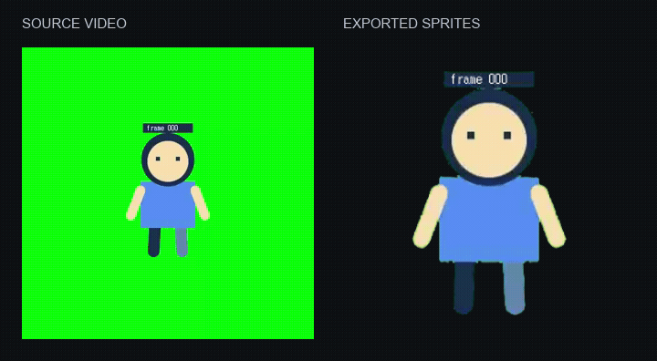
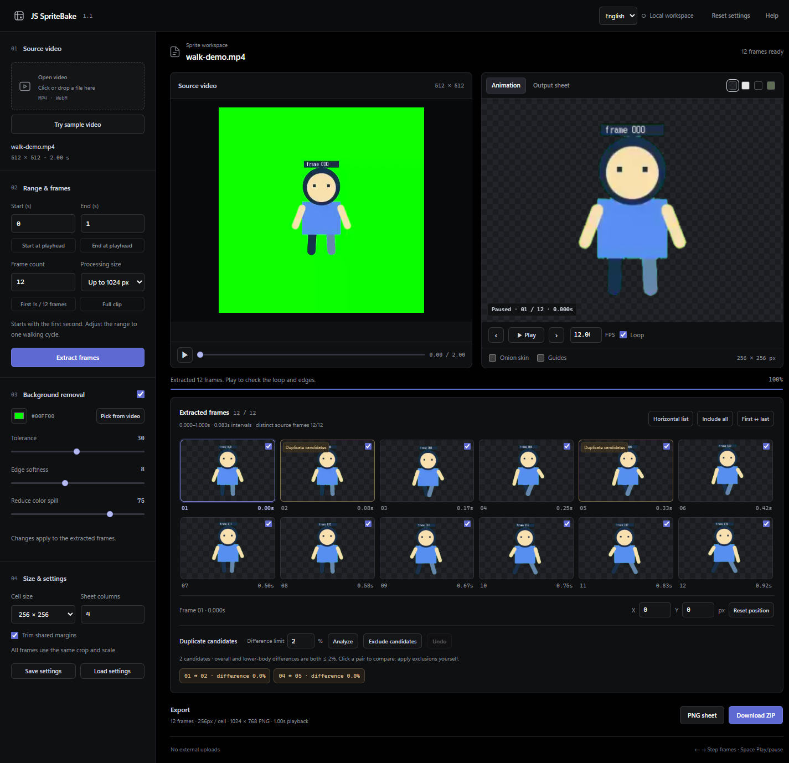
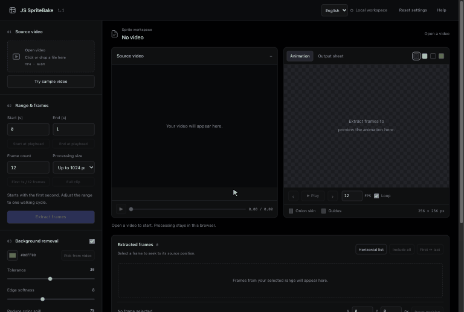
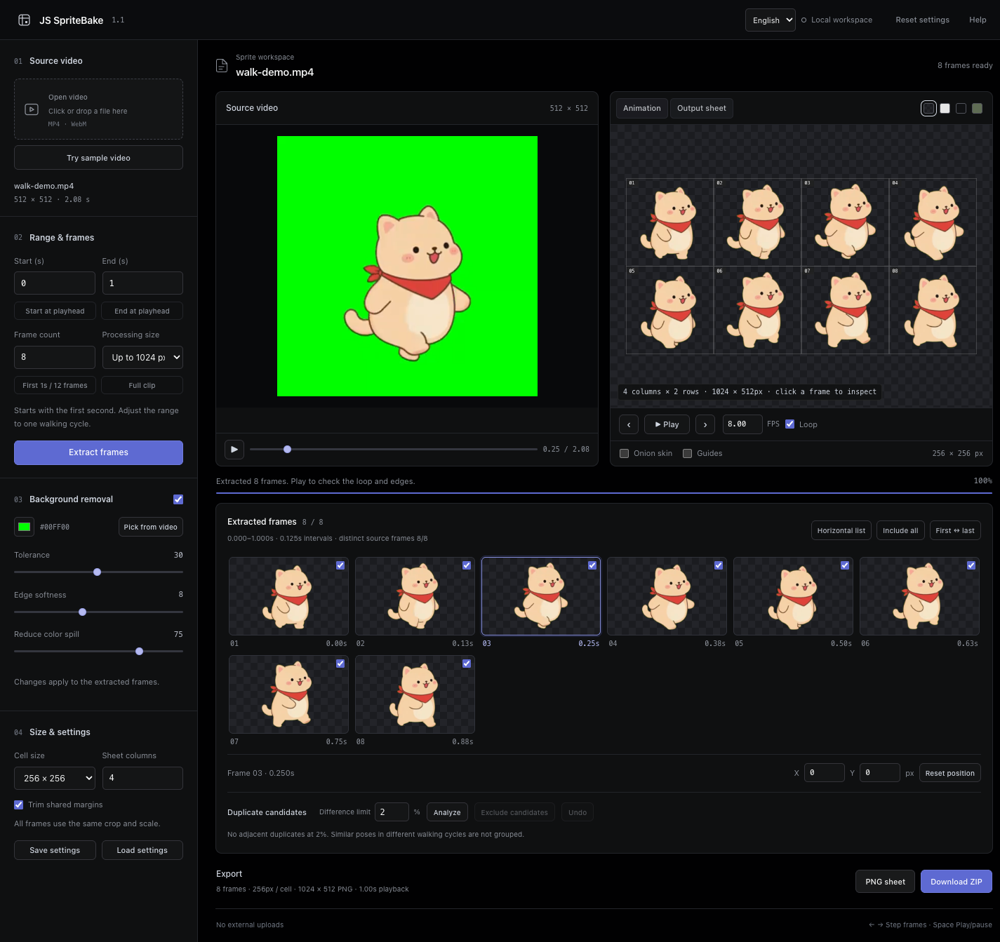

# JS SpriteBake

**Turn a local video into a transparent sprite sheet.**

English · [한국어](README.ko.md) · [日本語](README.ja.md)

[Download v1.1.1](https://github.com/JongSeok-327/js-spritebake/releases/tag/v1.1.1) · MIT · no API key · your video never leaves your computer



Pick a range from a video of your character on a solid background. JS SpriteBake samples evenly spaced frames, removes the background, keeps one crop and scale across the whole animation, and saves a transparent PNG sheet. You can also save a ZIP with individual frames and per-frame timing for your game engine.

[](docs/assets/editor-en.png)

**No footage yet?** Start the editor and click **Try sample video**. It loads the bundled 2-second clip of Kong, the hero of my game *kong-survivors*, extracts one walk cycle and plays it. See [sample details](docs/SAMPLES.md).

There are three ways to use it:

| | Best for | You need |
| --- | --- | --- |
| [**Editor**](#quick-start) | Tuning by eye: key color, frame exclusions, offsets | Python 3.9+ · Chrome or Edge |
| [**Command line**](#command-line) | Repeating the same settings, scripts, batch work | Node.js 22+ · Chrome or Edge |
| [**Claude Code skill**](#claude-code-skill) | "Make a sprite sheet from this clip" in plain language | Claude Code · Node.js 22+ · Chrome or Edge |

The editor is available in **English, 한국어 and 日本語**. Use the selector at the top right; your video and edits stay in place. The first visit follows your browser language, and `?lang=en`, `?lang=ko` or `?lang=ja` opens a specific one.

## Why I made this

I kept turning character videos into sprites while working on my projects, and thought a small tool like this would make the process easier. JS SpriteBake started as a personal convenience tool; I'm sharing it in case it helps someone else's workflow too.

## Quick start

### macOS

1. Download the [release ZIP](https://github.com/JongSeok-327/js-spritebake/releases/latest) and extract it.
2. Open **Terminal**, type `cd ` (with a space), drag the extracted folder onto the window, and press Return.
3. Run:

   ```sh
   ./start.command
   ```

4. Your browser opens **http://127.0.0.1:8765**. Keep Terminal open while you work. Press **Control+C** to stop.

macOS already includes `python3` (3.9). If Terminal asks to install the **Command Line Tools**, accept and run the command again. A newer Python from [python.org](https://www.python.org/downloads/) is used automatically when installed.

You can also double-click `start.command` in Finder. Because the script is not signed, macOS may block it the first time. Either keep using Terminal, or go to **System Settings → Privacy & Security** and click **Open Anyway** for that file. You do not need to turn off any security settings.

### Windows

1. Install Python 3.9+ from [python.org](https://www.python.org/downloads/). Tick **Add python.exe to PATH** in the installer.
2. Download the [release ZIP](https://github.com/JongSeok-327/js-spritebake/releases/latest) and **extract the whole folder**. Running it from inside the ZIP does not work.
3. Double-click **`start.cmd`**. It finds `py -3` or `python` and opens your browser.
4. Keep the command window open while you work. Press **Ctrl+C** in it to stop.

Already have Python? From the project folder you can run `python3 server.py` (macOS) or `py -3 server.py` (Windows).

## Using the editor



1. **Open video**: choose or drag in a video, or click **Try sample video**. MP4 (H.264) and WebM work best.
2. **Start / End** and **Frame count**: the range starts as the first second with 12 frames. For a walk, pick one full step cycle. The end time is not sampled, so a looping clip does not repeat its first pose.
3. **Extract frames**.
4. **Background removal**: set the color, or use **Pick from video** and click the background. If edges stay green, raise spill suppression or tolerance. If parts of the character vanish, lower tolerance. Check the result against both light and dark preview backgrounds.
5. Review frames with ‹ ›, onion skin and the checkboxes. X/Y fields nudge the selected frame. **Output sheet** previews the saved layout.
6. **Duplicate candidates** suggests adjacent frames that look the same. Click a pair to compare it, **Exclude candidates** to merge, **Undo** to restore. A merged frame's time goes to the frame before it.
7. Save with **PNG sheet** or **Download ZIP**.

Work is not saved automatically. To continue later, use **Save settings**. Next time, open the same video, load the settings, and extract again.

**Tips for source video:** keep the camera still, show the whole body with space around weapons or accessories, and use one even background color that does not appear on the character. Walking in place is easiest when your game moves the character itself.

## Output files



| File | Contents |
| --- | --- |
| `*-sheet.png` | Transparent sprite sheet (grid). |
| `frames/001.png` … | Individual transparent frames (ZIP only). |
| `*.json` | Each frame's position in the sheet, source time, offset, pivot and `durationMs` (ZIP only). |
| `*-settings.json` | Settings and frame edits to restore the work. It does not contain the video. |

**If you merged duplicates, play each frame for its `durationMs`** to keep the original speed. A PNG alone cannot store variable timing. Unchecking a frame by hand drops its time instead.

The default pivot `(0.5, 0.9)` is a fixed point in the cell, not a detected foot position. Guides, frame numbers and onion skin are never written into the PNG.

## Command line

`cli.mjs` runs the same pipeline as the editor in a hidden Chrome/Edge window, so the results match. It needs [Node.js 22+](https://nodejs.org/) and Chrome or Edge, and does not need Python.

```sh
node cli.mjs walk.mp4                                   # first second, 12 frames → walk-sprites.zip
node cli.mjs walk.mp4 --start 0.5 --end 1.5 --frames 16 --dedupe
node cli.mjs walk.mp4 --key-color "#0000ff" --format png --out sprites
node cli.mjs walk.mp4 --preset walk-settings.json       # reuse settings saved from the editor
```

Progress goes to stderr. The last line on stdout is the path of the saved file. Run `node cli.mjs --help` for every option:

| Option | Meaning | Default |
| --- | --- | --- |
| `--start`, `--end` | Range in seconds (end not sampled) | 0 → first second |
| `--frames` | Frames to sample, 2–64 | 12 |
| `--resolution` | Processing limit: 512, 1024, 2048 | 1024 |
| `--key-color` | Background color `#rrggbb` | `#00ff00` |
| `--tolerance`, `--softness`, `--despill` | 1–60, 0–20, 0–100 | 30, 8, 75 |
| `--no-key` | Keep the background | |
| `--cell`, `--columns` | Cell size 128/256/512/1024, columns 1–16 | 256, 4 |
| `--no-crop` | Do not crop to the shared content area | |
| `--fps` | Playback FPS written to the JSON | frames ÷ range |
| `--dedupe` | Merge suggested duplicates, keeping total time | |
| `--preset` | Settings JSON from the editor (flags override it) | |
| `--format` | `zip` or `png` | `zip` |
| `--out` | Output folder | current folder |
| `--browser` | Chrome/Edge path, if not in the usual place | auto |

`npm run bake -- walk.mp4` and, after `npm link`, `spritebake walk.mp4` work too.

## Claude Code skill

The repository is also a [Claude Code](https://claude.com/claude-code) plugin. It contains a `spritebake` skill that runs the command line for you. Install it in Claude Code:

```
/plugin install js-spritebake --marketplace JongSeok-327/js-spritebake
```

Older Claude Code versions use two steps: `/plugin marketplace add JongSeok-327/js-spritebake`, then `/plugin install js-spritebake@js-spritebake`.

Then ask in your own words, for example: *"Make a sprite sheet from ~/Movies/walk.mp4: green background, 8 frames, save to ./sprites."* Claude picks the options, runs the CLI and checks the sheet before replying. When you work inside this repository, `claude --plugin-dir .` loads the skill without installing it.

## Troubleshooting

| Problem | Fix |
| --- | --- |
| `Python 3.9 or newer is required` | Install Python from [python.org](https://www.python.org/downloads/) and open a new terminal. |
| macOS says `start.command` cannot be opened | Run `./start.command` in Terminal, or use **Open Anyway** in System Settings → Privacy & Security. |
| `Permission denied` on `./start.command` | Run `chmod +x start.command` once. |
| The browser does not open | Copy the address printed in the terminal into Chrome or Edge. |
| `No free local port` | Run `python3 server.py --port 8900`. |
| The video will not load | The browser cannot decode it. Use MP4 (H.264) or WebM and convert with a tool you trust. |
| The animation barely moves | The range is too short for the frame count (frames repeat) or too long (poses are skipped). Check the frame diagnostics under the frame list. |
| `Chrome or Edge was not found` (CLI) | Install one, or pass `--browser <path>` / set `SPRITEBAKE_BROWSER`. |
| `Node.js 22 or newer is required` (CLI) | Install the LTS version from [nodejs.org](https://nodejs.org/). |
| The page looks out of date | Force a reload: Ctrl+F5 (Windows) or Command+Shift+R (macOS). |

Verified on Windows (Python 3.11, Chrome) and macOS on Apple Silicon (built-in Python 3.9, Chrome). Safari, Firefox and phones are not tested.

## Limits

- 2–64 frames, processing up to 2048px (the source is never upscaled). Large jobs need a lot of memory. Lower the resolution or frame count if things slow down.
- Background removal is color keying. It does not use AI. Character colors that match the background, blur, shadows and fine hair may need better footage.
- There is no automatic walk-cycle detection, stabilization or frame interpolation. Duplicate detection is a heuristic.

## Privacy and security

- Videos are read and processed inside your browser. Nothing is uploaded, and there are no accounts, analytics, cookies or external requests.
- The local server listens on `127.0.0.1` only. It serves just the app files and rejects other hosts and origins. Do not expose it through port forwarding or tunnels.
- Exported JSON contains the source file name. Check it before sharing.

Details are in [SECURITY.md](SECURITY.md).

## Development

No build step and no `pip`/`npm install` are needed.

```sh
npm run check && npm test                                  # syntax, core logic, translations (Node 22+)
python3 -m unittest discover -s tests -p "test_*.py"       # server boundaries
node tests/browser-check.mjs http://127.0.0.1:8765         # full editor + CLI check, server running
```

The browser check generates its own test video and writes temporary files to the ignored `.qa/` folder. Set `SPRITE_TEST_BROWSER` for a nonstandard Chrome path. README screenshots come from the bundled sample: `node tests/capture-previews.mjs http://127.0.0.1:8765`; walkthrough GIFs from `node tests/capture-walkthrough.mjs <URL> <lang>` then `python3 tests/make-walkthrough-gif.py <lang>` (needs Pillow). UI text lives in `dist/i18n.js`. See [CONTRIBUTING.md](CONTRIBUTING.md).

## License and credits

[MIT](LICENSE). The license covers this project's code, documentation and bundled sample files, not the videos or characters you import. The Kong character belongs to the author; see [docs/SAMPLES.md](docs/SAMPLES.md). Research references are listed in [ACKNOWLEDGEMENTS.md](ACKNOWLEDGEMENTS.md), and release notes are in [CHANGELOG.md](CHANGELOG.md).
